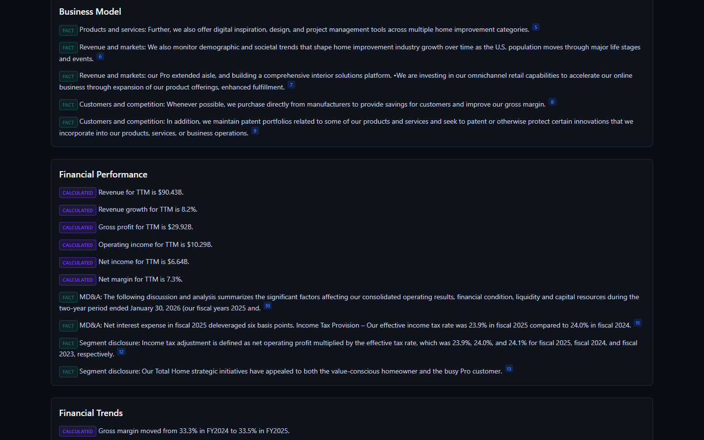
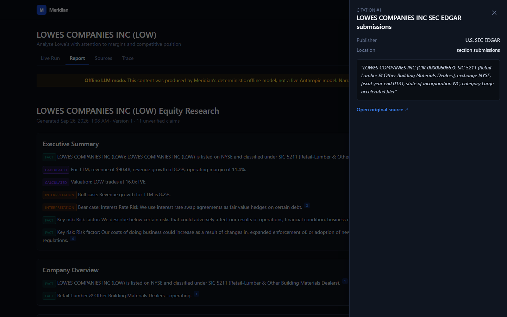
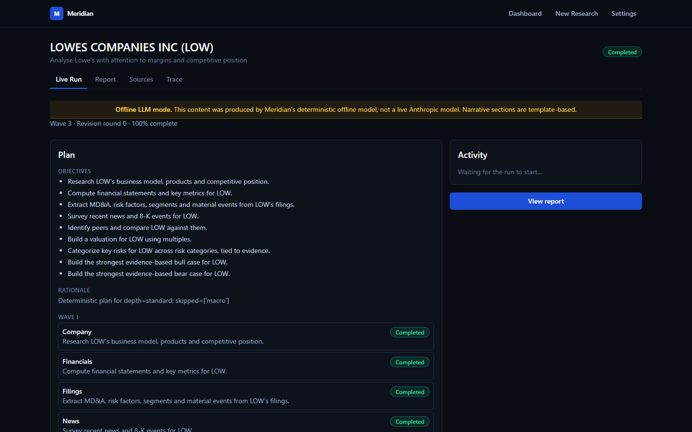
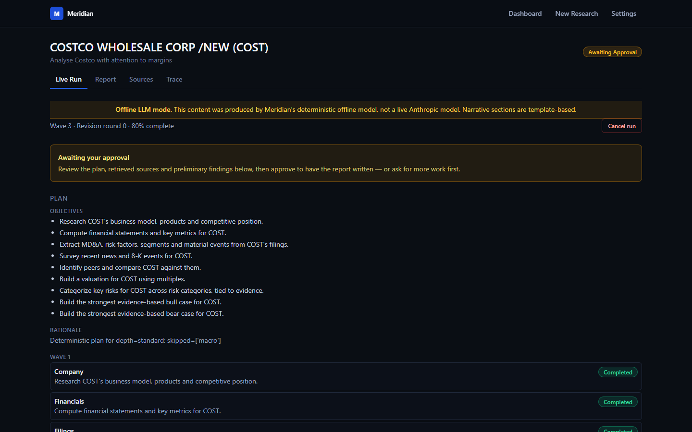
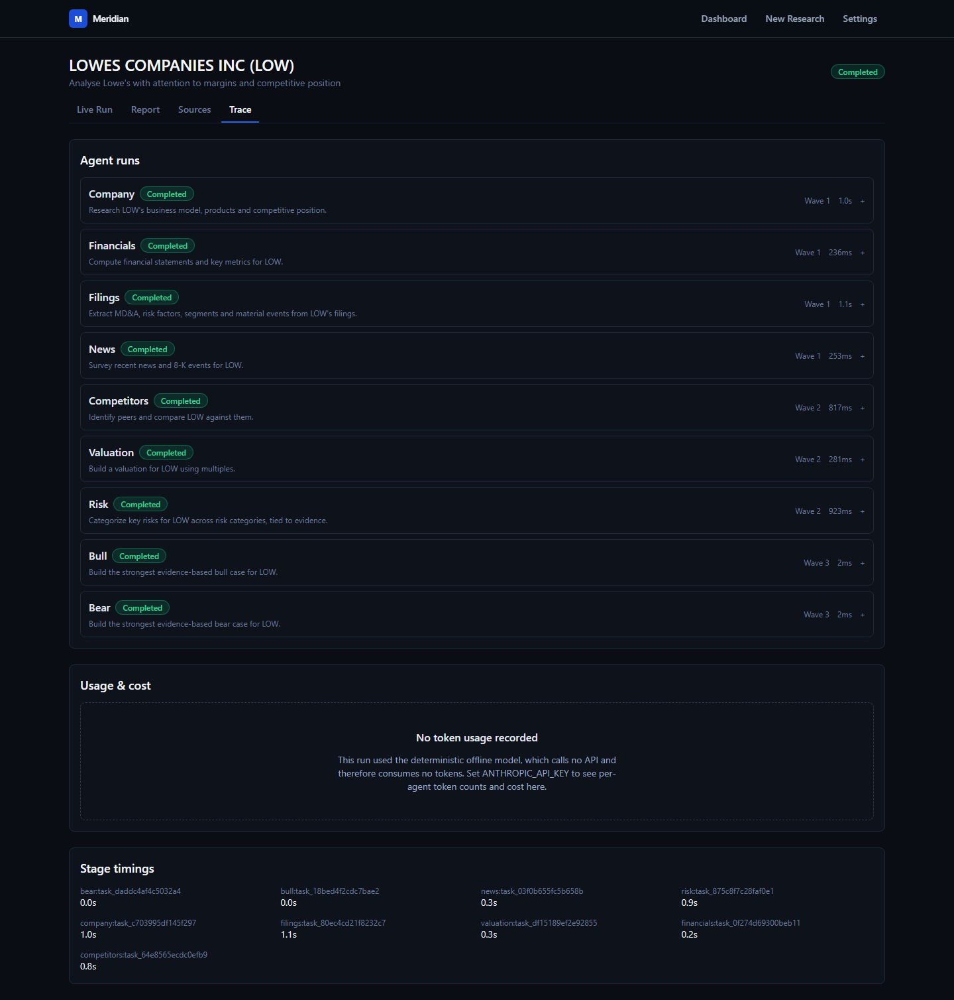
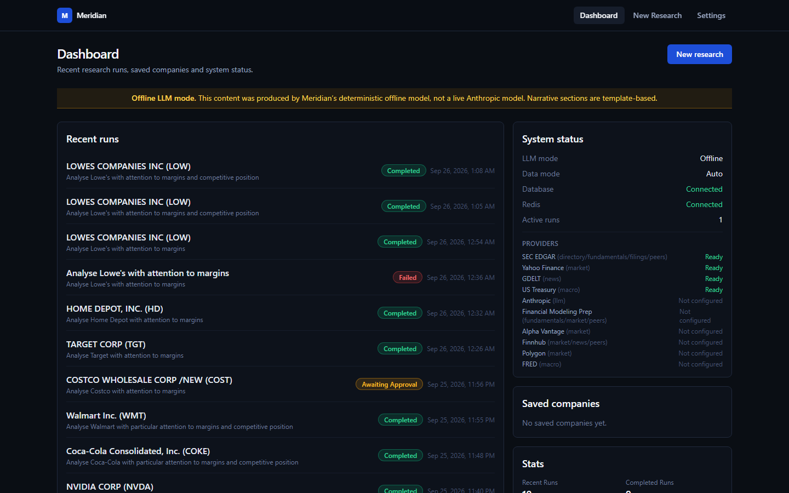
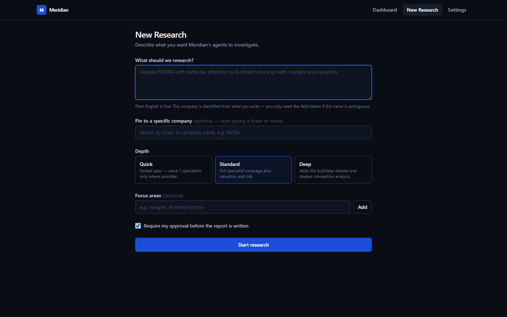
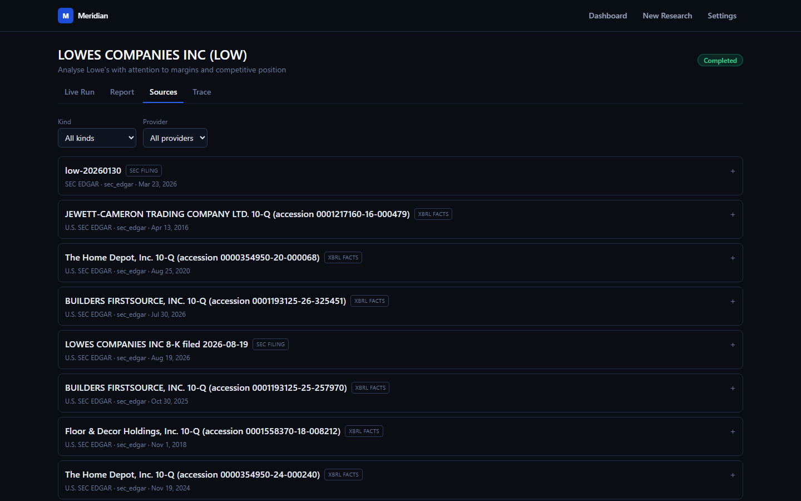
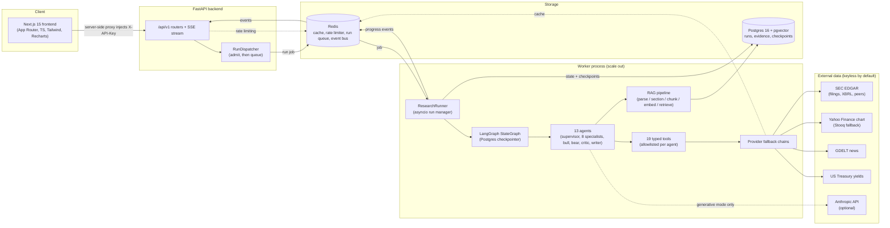
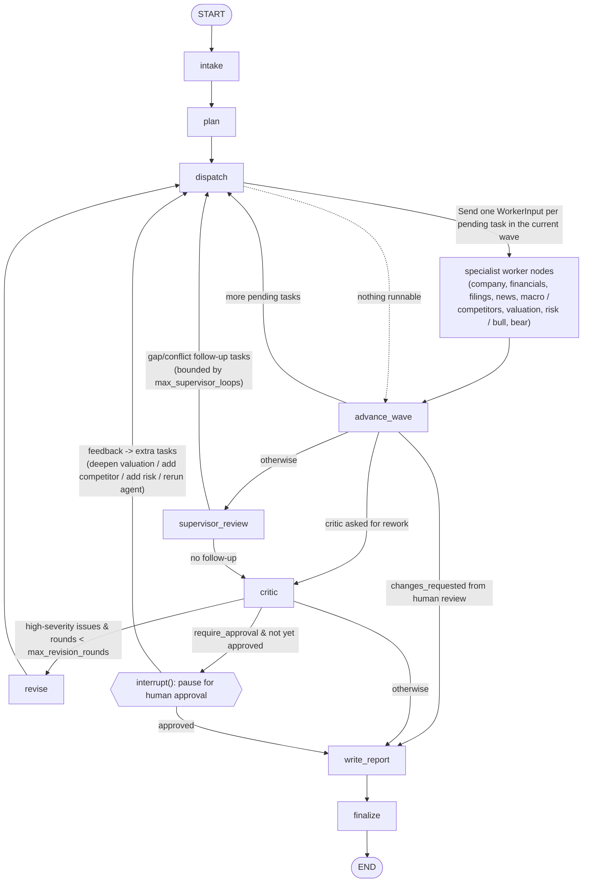

# Meridian

Meridian is a multi-agent equity research platform. Point it at a company and a research question —
*"Analyse NVIDIA with attention to AI infrastructure growth, margins and valuation"* — and it resolves the
company, plans the research, dispatches specialist agents in parallel waves, pulls evidence from SEC EDGAR
filings, market data and news, computes every financial metric in deterministic Python (never in the
language model), challenges its own conclusions through a critic loop, optionally pauses for a human
approval gate, and writes a citation-backed report where every fact traces back to a real source.

It is a decision-support tool, not investment advice. Every report separates **Fact**, **Calculated** and
**Interpretation** content and carries a disclaimer.

## Why this exists

Most "AI research agent" demos either hard-code the output or let a language model quietly invent numbers.
Meridian is an attempt to build the boring, correct version of that idea: an LLM is good at reading a
messy 10-K and being told what a number means, and bad at arithmetic and bad at knowing when it's making
something up. So arithmetic never touches the model — a pure-Python financial engine computes every ratio,
margin, multiple and DCF from parsed XBRL figures — and every claim an agent writes down must resolve to
an evidence id it actually retrieved or a metric reference the engine actually computed. A critic agent
then re-checks all of that mechanically (not just by asking the model to grade itself) before a report
writer is allowed to compose prose from it.

The interesting engineering is less "can an LLM write a report" and more: what does it take to make a
multi-agent system's *claims* trustworthy — typed evidence chains, a deterministic calculation boundary,
citation validation that rejects fabricated markers, and a critic that parses figures out of English
sentences and checks them against a metrics table with the same precision they were written at.

## Status, honestly

This is a from-scratch build, verified end to end in **offline deterministic mode**. Read this before
anything else:

- **Generative mode works with any OpenAI-compatible endpoint**, not just Anthropic: set `LLM_BASE_URL`
  and it runs against Google Gemini, Groq, Cerebras, Mistral, OpenRouter, GitHub Models — or a local
  Ollama, with no key and no network. A full 13-agent generative run is covered end to end against a
  real HTTP server speaking the protocol, so the request shapes, the Anthropic-to-OpenAI message
  translation and the tool loops are verified rather than assumed. **The Anthropic client specifically
  has still never run against the live API** — no key was available — so its vendor-specific pieces
  (beta fallback headers, refusal handling, `output_config`) remain unverified.
- **Postgres and the Docker stack are verified.** Both images build, all four containers come up healthy,
  the Alembic migration runs on container start, and a full research run completes in the containerised
  stack with results persisted (a Microsoft run: 60s, 13 sections, 933 sources, 11,553 evidence records).
  The DB integration tests and the pgvector store tests pass against a real pgvector instance, and skip
  cleanly when one is not reachable.
- **Runs execute in a worker process, not the API.** The API persists the request, puts a job on a
  Redis queue and returns; a worker pops it and drives the graph. Graph state is checkpointed to
  Postgres after every step, so a run survives the worker dying: kill a worker mid-run with SIGKILL and
  the restarted one resumes that run from its last checkpoint rather than starting over (verified —
  it finished and produced its report). Progress still streams live over SSE, because the worker
  publishes events on Redis and the API forwards them to the browser. Scale with
  `docker compose up -d --scale worker=3`. Set `RUN_EXECUTOR=inprocess` to run everything in the API
  instead, which is what the CLI and the tests do.
- **Without an API key, the system runs in deterministic offline mode**: every specialist agent has a
  non-generative code path that derives findings directly from tool output, so a full run produces real
  figures and real citations, but mechanical, template-driven prose rather than model-written analysis.
- This is **not production-ready and has not been deployed anywhere**. It is a from-scratch reference build.

None of that is hidden in the code, either — see the git history for the actual bugs found while making
each part work (wrong fiscal year from SEC XBRL tagging, a wrong company resolved from a plain-English
query, Stooq silently switching to an anti-bot page, and others), documented in
[`docs/DATA_SOURCES.md`](docs/DATA_SOURCES.md) and the commit messages themselves.

## Screenshots

All captured from real runs against live SEC EDGAR data, in offline LLM mode (no API key), running in
Docker. Nothing here is mocked or staged.

**The report** — every paragraph is tagged `FACT`, `CALCULATED` or `INTERPRETATION` and carries a
citation marker. The figures come from the deterministic financial engine, not the model.



**The citation drawer** — clicking any marker opens the exact evidence behind the claim: source,
publisher, filing section and the quoted passage.



**A run in flight** — waves of specialist agents with per-agent status and a live event feed over SSE.



**The human approval gate** — the run pauses before the report is written so a human can inspect the
plan, the retrieved sources and the preliminary findings, then approve or demand more work.



**The trace** — per-agent tool calls, durations and token/cost accounting.



<details>
<summary>Dashboard, request form and sources view</summary>







</details>

## Architecture at a glance



Full component breakdown, the typed shared state, the determinism boundary and the request lifecycle are
in [`docs/ARCHITECTURE.md`](docs/ARCHITECTURE.md).

## The multi-agent workflow



Every worker node feeds the single fan-in point `advance_wave`; a conditional edge there (`route_after_wave`
in `graph/routing.py`) is what makes the same collector serve four different loops — initial waves,
supervisor follow-up, critic revision and post-approval extra work — without threading extra state through
the tasks themselves. Safeguards: `max_revision_rounds=2`, `max_supervisor_loops=2`, a LangGraph recursion
limit, per-task fingerprint dedup (a task is never dispatched twice for the same fingerprint), a per-agent
timeout, and a failed specialist is recorded without aborting the run. Details in
[`docs/ARCHITECTURE.md`](docs/ARCHITECTURE.md) and [`docs/AGENTS.md`](docs/AGENTS.md).

## The 13 agents

| Agent | Wave | Responsibility | Tools (allowlist) | Output |
|---|---|---|---|---|
| Supervisor | plan / review | Resolves the company, builds a deterministic wave plan (optionally LLM-refined), reviews results for gaps and conflicts, builds revision/feedback tasks | `resolve_company` | `ResearchPlan`, follow-up tasks, conflict list |
| Company | 1 | Business model, products, geography, competitive position from the 10-K and profile | `resolve_company`, `get_company_profile`, `search_filings`, `get_filing_section`, `recall_research_memory` | Findings → Company Overview, Business Model |
| Financials | 1 | Financial performance, trends and ratios, strictly from engine-computed metrics | `get_financial_statements`, `compute_financial_metrics`, `calculate_metric` | `FinancialMetrics` + findings → Financial Performance/Trends, Key Ratios |
| Filings | 1 | MD&A, segments, risk factors, guidance, accounting changes and material events from 10-K/10-Q/8-K | `list_filings`, `index_filings`, `search_filings`, `get_filing_section`, `get_recent_8k_events` | Findings → Financial Performance, Key Risks, Recent Developments |
| News | 1 | Recent news and 8-K events, keeping factual reporting separate from interpretation | `search_news`, `get_recent_8k_events` | Findings → Recent Developments |
| Macro | 1 (conditional) | Only asserts a rates/inflation/trade/FX link when the company's own filing text supports it | `get_macro_indicators`, `search_filings` | Findings → Macro, or zero findings with a stated reason |
| Competitors | 2 | Peer identification and comparison on growth/margins | `find_peer_candidates`, `get_peer_snapshot`, `search_filings` | `PeerComparison` + findings → Industry & Competition |
| Valuation | 2 | Trading multiples vs. peers and an optional DCF whose assumptions are always derived deterministically | `get_market_quote`, `compute_financial_metrics`, `calculate_metric`, `run_dcf`, `get_peer_snapshot` | `ValuationResult` + findings → Valuation |
| Risk | 2 | Categorised risks (financial, liquidity, debt, competitive, regulatory, operational, concentration, geopolitical, technology, valuation), each tied to filing evidence or a metric | `search_filings`, `get_filing_section`, `calculate_metric` | Findings → Key Risks |
| Bull | 3 | Strongest evidence-based bull case, argued only from findings/evidence already in state | `lookup_evidence`, `search_filings` | Findings → Bull Case |
| Bear | 3 | Strongest evidence-based bear case, same constraint | `lookup_evidence`, `search_filings` | Findings → Bear Case |
| Critic | review | Deterministic integrity checks (hallucinated evidence, unsupported facts, figures vs. metrics table, stale developments, duplicates, contradictions) + optional LLM judgement pass | none | `CriticReview`, per-finding status changes |
| Report Writer | final | Composes the report strictly from approved/unverified findings; rejects any `[ev_xxx]` marker that doesn't resolve | none | `ResearchReport` |

Depth (`quick` / `standard` / `deep`) and focus areas adjust the plan: `quick` drops macro and bull/bear;
`deep` adds a DCF and more peers. Full detail — including the critic's exact checks and how the supervisor
decides to skip an agent — is in [`docs/AGENTS.md`](docs/AGENTS.md).

## Technology stack

| Layer | Choice |
|---|---|
| Agent framework | LangGraph 1.2 `StateGraph`, `Send` fan-out, `interrupt` for human-in-the-loop |
| LLM | Anthropic SDK 1.x behind an `LLMProvider` interface, with a deterministic `OfflineLLMProvider` and a `ScriptedLLMProvider` for tests |
| Backend | Python 3.12, FastAPI, Pydantic 2, SQLAlchemy 2 (async) + Alembic |
| Database | PostgreSQL 16 with pgvector (documents/chunks, evidence, findings, runs, telemetry) |
| Cache | Redis with typed TTL policy, in-memory fallback |
| Embeddings | fastembed (`BAAI/bge-small-en-v1.5`), deterministic hashing fallback |
| Frontend | Next.js 15 App Router, TypeScript (strict), Tailwind CSS, Recharts |
| Observability | structlog JSON logs, DB-persisted runs/tool calls/usage, optional OpenTelemetry + LangSmith |
| Testing | pytest (`asyncio_mode=auto`), respx for HTTP mocking, vitest for the frontend |

## Getting started

### Prerequisites

Python 3.12, Node.js 20+, and (optionally, for the full stack) Docker Desktop and/or a local Postgres 16
with the `pgvector` extension and Redis 7.

### Windows (PowerShell)

```powershell
scripts\setup.ps1          # backend venv + pip install, npm install, copy .env files
scripts\docker-up.ps1 -DepsOnly   # start Postgres + Redis only (or point DATABASE_URL/REDIS_URL at your own)
scripts\migrate.ps1        # alembic upgrade head
scripts\dev.ps1            # runs backend (uvicorn --reload) and frontend (next dev) together
```

Every `scripts\*.ps1` file is a line-for-line PowerShell equivalent of the matching `make` target — see the
comments at the top of each script.

### Linux / macOS (Makefile)

```bash
make setup          # backend venv + pip install, npm install, copy .env files
make docker-up-deps # docker compose up -d db redis
make migrate        # alembic upgrade head
make dev            # uvicorn --reload + next dev together
```

`make help` lists every target (`test`, `lint`, `format`, `docker-up`, `eval`).

### Running without Postgres/Redis at all

The backend starts and serves a full offline research run with **no database and no Redis**: `/health`
reports `database: false, redis: false` and the API still works — state lives in-process, and the RAG
pipeline falls back to an in-memory vector store. This is the mode verified on the development machine:

```bash
cd backend
.venv/Scripts/python.exe -m uvicorn meridian.api.app:create_app --factory --port 8000   # Windows
# .venv/bin/python -m uvicorn meridian.api.app:create_app --factory --port 8000          # Linux/macOS
curl http://127.0.0.1:8000/health
# {"status":"ok","version":"0.1.0","database":false,"redis":false,"auth_required":false}
```

### Environment variables

Copy `.env.example` to `.env`; every value is optional. Key groups (see the file for the full, commented
list):

| Variable | Purpose |
|---|---|
| `ANTHROPIC_API_KEY`, `LLM_PROVIDER=auto` | With a key set, `auto` uses Anthropic; without one, deterministic offline mode |
| `MODEL_PLANNER` / `MODEL_WORKER` / `MODEL_CRITIC` / `MODEL_WRITER`, `EFFORT_*` | Per-tier model and reasoning-effort selection |
| `DATABASE_URL`, `REDIS_URL` | Postgres / Redis connection strings |
| `DATA_MODE=auto` | `live` (network only), `snapshot` (recorded fixtures only), `auto` (live with snapshot fallback) |
| `SEC_USER_AGENT` | Required format for SEC EDGAR: `"Company/Name email@domain"` |
| `FMP_API_KEY`, `ALPHA_VANTAGE_API_KEY`, `FINNHUB_API_KEY`, `POLYGON_API_KEY`, `FRED_API_KEY` | Optional paid/free-tier providers; adapters activate automatically when a key is present |
| `API_KEY`, `RATE_LIMIT_PER_MINUTE` | API auth and rate limiting (open API when `API_KEY` is unset — local dev only) |
| `REQUIRE_APPROVAL_DEFAULT`, `MAX_REVISION_ROUNDS` | Workflow safeguards |

The frontend has its own `frontend/.env.local` (`MERIDIAN_API_BASE_URL`, `MERIDIAN_API_KEY`) — these are
server-side only; the browser never sees the API key.

## Docker

`docker-compose.yml` at the repo root defines `db` (pgvector/pgvector:pg16) and `redis` (redis:7-alpine)
as always-on datastore services, plus `backend`, `worker` and `frontend` behind a `full` profile.
`docker/backend.Dockerfile` and `docker/frontend.Dockerfile` are multi-stage, non-root, healthchecked
images. The worker shares the backend image and entrypoint, with `RUN_MIGRATIONS=0`: the API owns the
schema, and two containers running `alembic upgrade head` at once race on the version table, so the
worker waits for the schema instead of applying it.

```bash
make docker-up-deps   # just Postgres + Redis, for local dev against the venv
make docker-up        # full stack, built and started
docker compose up -d --scale worker=3   # more workers; they coordinate through Redis
```

Verified end to end: all five containers report healthy, migrations apply on start, the app containers
run as non-root, and a run submitted to the API executes in the worker, streams its progress to the
browser over SSE, and persists its report to Postgres. Killing a worker mid-run with SIGKILL leaves the
run recoverable: the restarted worker resumes it from its last checkpoint and it completes.

## Testing

```bash
cd backend
.venv/Scripts/python.exe -m pytest tests/unit -q
```

**578 passed, 1 skipped, 9 deselected** on this machine (deselected = `@pytest.mark.live` tests that hit
real external APIs, excluded by the default `-m ''not live''`; the one skip is
`test_pgvector_store.py`, which needs a reachable Postgres). Integration tests under
`backend/tests/integration` are marked `@pytest.mark.integration` and skip cleanly without Postgres/Redis.

Two end-to-end tests in `backend/tests/e2e/` drive the real graph against live SEC data: one asserts that
"Analyse Microsoft" yields a report whose every citation resolves, the other that a fabricated company
fails rather than resolving to something plausible.

```bash
.venv/Scripts/python.exe -m pytest tests/e2e -m integration -q     # ~60s, needs network
```

Linting and type-checking, both wired into CI and `make lint`:

```bash
.venv/Scripts/python.exe -m ruff check src tests && .venv/Scripts/python.exe -m mypy src
```

Frontend: `npm run lint && npx tsc --noEmit && npm run test && npm run build` inside `frontend/`.

## Evaluation

```bash
python evals/run_eval.py              # seven benchmark cases, ~1 min each
python evals/run_eval.py --snapshot   # recorded data only, no network
```

Seven cases covering different fiscal calendars, a bank whose margins must be absent rather than wrong, a
natural-language request, quick depth, a company that does not exist, and a prompt-injection harness.
Latest run: **7/7 passed**, with citation coverage, source correctness and calculation accuracy all at
1.000 and zero unsupported claims in the finished reports.

Those scores measure the deterministic pipeline -- retrieval, calculation, citation integrity and the
critic's rules -- not the quality of generated prose, because offline mode generates none. Methodology,
full results and honest limitations: [`docs/EVALUATION.md`](docs/EVALUATION.md); scorecards land in
`evals/results/`.

## Security

Prompt-injection defence (retrieved text only ever enters the model inside delimited, clearly-labelled
`<untrusted_evidence>` blocks, never the system role), an outbound SSRF allowlist, per-agent tool
allowlists, parameterised SQL only, a server-side API-key proxy so the browser never holds a credential,
Redis-backed rate limiting, and a strict frontend CSP. Full writeup, including residual risks, in
[`docs/SECURITY.md`](docs/SECURITY.md).

## Limitations

- **The Anthropic client has never run against the live API** — no key was available. Generative mode
  itself is verified: a full research run completed against Google Gemini, 29 model calls, zero HTTP
  errors, a 12-section report with resolvable citations. What stays unverified is Anthropic-specific:
  the beta fallback header, refusal `stop_reason` handling and `output_config`.
- **Agents under Gemini produce claims they cannot source.** In a live run, 20 findings came back
  unverified — the `risk` agent produced no sourced findings at all, and `financials` ten. They are
  marked unverified and kept out of the cited body rather than presented as sourced, so nothing false
  is published, but the report is thinner than it should be. This is prompt tuning against a real
  model, and it is the open item: the prompts were written against a scripted fake that never pushed
  back. (A related defect — the model citing *finding* ids rather than *evidence* ids — is fixed: those
  markers now resolve to the finding's own evidence.)
- **Free tiers meter aggressively.** `gemini-flash-latest` exhausted its quota within one run;
  `gemini-flash-lite-latest` has a workable one. `LLM_REQUESTS_PER_MINUTE` paces the calls, which makes
  a run take minutes rather than seconds. That is the cost of running generative mode for free.
- **Admission is capped at four concurrent runs** (`MAX_CONCURRENT_RUNS`); a fifth is refused with
  `429`, not queued. The cap is reserved atomically in Redis, so ten simultaneous requests admit
  exactly four however many API replicas they hit.
- **A crashed worker's run is recovered on a timer, not instantly.** The dead worker's claim expires
  after 20s and a sweep runs every 20s, so recovery lands within about a minute. A run parked at
  `awaiting_approval` is never auto-resumed: it is waiting for a person, and resuming it would walk
  straight through the approval gate.
- **Embedding is CPU-bound and this machine is the bottleneck.** ~80-100ms per chunk, so indexing a
  large filing set cold takes minutes. Several cold runs at once can push an agent past
  `AGENT_TIMEOUT_SECONDS`; it fails, is recorded as failed, and the run continues without it rather
  than hanging. A GPU or a hosted embedding endpoint is the real answer.
- **Single-process mode is still the default** (`RUN_EXECUTOR=inprocess`) and is what the CLI and the
  test suite exercise. Docker compose sets `worker`. Without Redis, worker mode falls back to
  in-process with a warning rather than failing to start.
- Without an LLM key, report prose is mechanically composed from finding claims — correct and cited, but
  not fluent analysis.
- Stooq (the documented keyless price source) currently returns an anti-bot challenge page instead of CSV;
  the platform works around this with an unofficial Yahoo Finance chart endpoint as the primary keyless
  source, which could change or disappear without notice.
- SEC's `browse-edgar` SIC Atom feed has a long-standing server bug that renders company names as literal
  `ARRAY(0x...)` strings; peer discovery falls back to ranking XBRL revenue frames when this happens.
- GDELT enforces an informal, undocumented rate limit and no key-based alternative is wired in by default.
- **Filing text is extracted from HTML, and extraction is imperfect.** Page-break navigation, section
  headings and flattened tables are filtered out of quoted claims; chunk overlap carries whole
  sentences, and a paragraph that opens mid-sentence is rejoined to the one before it, since HTML
  extraction splits sentences at line, cell and page boundaries. No chunk in the current index opens
  mid-sentence, against 60.5% before that work. What survives is page headers and table captions that
  read like prose; the cited evidence always holds the full passage.
- This is a reference build for one machine, not a deployed or load-tested service.

## Roadmap

- Run generative mode against a real model (free Gemini/Groq tier or local Ollama) and tune the prompts
  on what it actually produces, rather than on what a schema-valid stand-in returns.
- Move embedding off the CPU (GPU or a hosted endpoint); it is the throughput limit on cold indexing.
- A keyed market-data provider (FMP/Polygon) as the default primary, with Yahoo/Stooq as fallback only.
- Extract filing tables as structured rows rather than flattening them into text, so the figures in them
  become citable metrics instead of being filtered out of claims.
