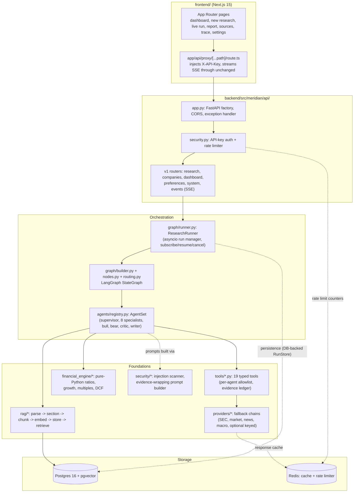

# Architecture

This document describes how Meridian's components fit together, the typed shared state that flows through
the graph, why LangGraph, the determinism boundary between the LLM and the financial engine, persistence
and caching, failure handling, and the request lifecycle from an HTTP POST to a finished report.

See the repository root [`README.md`](../README.md) for the honesty notes on what is and isn't verified
(no live Anthropic key, no verified Postgres/Docker run). Everything below describes what the code does;
it does not claim any of it has been exercised against real infrastructure beyond what the README states.

## Components



- **`backend/src/meridian/api/`** — `app.py` builds the FastAPI app (`create_app`, a factory so both
  `uvicorn --factory` and tests can construct fresh instances); `wiring.py` assembles the `Runtime`
  (settings, providers, agents, graph, runner) once per process; `routers/` implements every endpoint in
  the frozen `schemas/api.py` contract; `security.py` is API-key auth plus the rate limiter; `live.py`
  drives the SSE stream with `Last-Event-ID` replay.
- **`backend/src/meridian/graph/`** — the LangGraph `StateGraph` itself (`builder.py`), the node bodies
  (`nodes.py`), the conditional-edge routing decisions (`routing.py`, deliberately separated from nodes so
  a node *does* something and a routing function only *decides*), the state-reducer helper
  (`state_ops.updates_from_result`) and `runner.py` (the process-level `ResearchRunner`).
  See [request lifecycle](#request-lifecycle) below for how these fit together end to end.
- **`backend/src/meridian/agents/`** — `base.py`'s `BaseAgent` template method (`execute` -> `run`),
  the orchestration agents (`supervisor.py`, `critic.py`, `report_writer.py`) and the 8 specialists plus
  bull/bear. See [`AGENTS.md`](AGENTS.md) for per-agent detail.
- **`backend/src/meridian/tools/`** — 19 typed tools (`tools/factory.py:build_tool_registry`) that wrap
  providers, the financial engine and the RAG retriever behind validated Pydantic inputs/outputs. Every
  tool call absorbs its result's sources/evidence into the calling agent's `ToolContext.ledger` and renders
  values with their evidence ids inline in the summary text the model reads back — so a generative agent
  can only ever cite an id it has actually seen.
- **`backend/src/meridian/providers/`** — one module per external data source plus `chain.py`'s generic
  `_FallbackChain`, and `factory.py:build_providers`, which assembles the concrete `ProviderRegistry` for a
  process (see [`DATA_SOURCES.md`](DATA_SOURCES.md)).
- **`backend/src/meridian/financial_engine/`** — pure functions, no I/O, no LLM: `compute_metrics`,
  `calculate`, `run_dcf`. This is the determinism boundary described below.
- **`backend/src/meridian/rag/`** — filing ingestion and hybrid retrieval (see [`RAG.md`](RAG.md)).
- **`backend/src/meridian/security/`** — `injection.py` (pattern-based scanner) and `prompting.py` (the
  only place that builds LLM messages containing retrieved text) — see [`SECURITY.md`](SECURITY.md).
- **`backend/src/meridian/db/`** — SQLAlchemy 2 async models, Alembic migration, and repositories used by
  the DB-backed `RunStore`/memory/preferences implementations wired in `api/persistence.py`.
- **`frontend/`** — Next.js 15 App Router. The browser never holds the backend's API key: every request
  goes through `app/api/proxy/[...path]/route.ts`, a server-side route handler that injects
  `X-API-Key: $MERIDIAN_API_KEY` and streams SSE responses through unchanged.

## The typed shared state and its reducers

`meridian.schemas.state.ResearchState` (a Pydantic `BaseModel`) is the single object LangGraph threads
through every node. Several agents run concurrently within one wave (dispatched via `Send`), and LangGraph
merges their partial state updates back together at the next super-step using **annotated reducers** —
without them, the second agent's update would silently overwrite the first's:

```python
tasks: Annotated[dict[str, ResearchTask], merge_dict]        # shallow-merge dicts (per-task by id)
outputs: Annotated[dict[str, AgentOutput], merge_dict]         # agent -> latest output
output_history: Annotated[list[AgentOutput], append_list]      # every output ever produced, in order
completed_fingerprints: Annotated[list[str], union_list]        # de-duplicating union, order-preserving
sources: Annotated[dict[str, Source], merge_dict]
evidence: Annotated[dict[str, Evidence], merge_dict]
financials: Annotated[FinancialStatements | None, keep_latest]  # last non-None write wins
critic_reviews: Annotated[list[CriticReview], append_list]
tool_calls: Annotated[list[ToolCallRecord], append_list]
usage: Annotated[list[LLMUsage], append_list]
timings: Annotated[dict[str, float], merge_dict]
```

Four reducer shapes cover every case in `schemas/state.py`:

- `merge_dict` — shallow `{**left, **right}`; safe because two parallel agents in the same wave write
  disjoint dict keys (their own sources/evidence/tasks), never the same key.
- `append_list` — concatenation; used for anything that should simply accumulate (history, tool calls,
  usage, errors).
- `union_list` — de-duplicating list union, preserving first-seen order; used only for
  `completed_fingerprints` so a fingerprint is recorded once no matter how many wave-mates finish it.
- `keep_latest` — `right if right is not None else left`; used for the "single current value" fields
  (`financials`, `metrics`, `quote`, `peers`, `valuation`) where whichever agent last computed them wins.

Fields without a reducer annotation (`company`, `plan`, `current_wave`, `revision_round`,
`supervisor_loops`, `approval`, `report`, scalars in general) are written by exactly one node at a time
(intake, plan, dispatch, critic, human_review, write_report respectively), so LangGraph's default
last-write-wins is correct for them.

`ResearchState` also carries read-only helper methods used throughout the agents and API layers:
`output(agent)`, `findings(agents=None)`, `approved_findings()` (status `APPROVED` or `UNVERIFIED` — never
`REJECTED`), and `uses_snapshot_data()` (true if any source was served from a recorded snapshot rather than
a live fetch).

## Why LangGraph

The workflow needs three things a plain task queue or a linear agent chain doesn't give you cleanly:

1. **Fan-out/fan-in with heterogeneous parallel work.** A wave dispatches a different agent per task
   (`Send(task.agent.value, WorkerInput(task, snapshot))` in `routing.route_dispatch`), each with its own
   node, and they all converge on one collector (`advance_wave`) whose conditional edge decides what
   happens next based on *why* that batch ran — more waves, a critic revision, a feedback follow-up, or the
   initial plan finishing. Reducers (above) are what make that fan-in safe.
2. **Loops with a hard stop.** The critic-to-revision loop and the supervisor's gap-review loop are true
   graph cycles (`critic -> revise -> dispatch -> ... -> critic`), not `while` loops in application code,
   which makes the iteration caps (`max_revision_rounds`, `max_supervisor_loops`) and LangGraph's own
   `recursion_limit` a structural safety net rather than something every loop has to remember to check.
3. **A real pause/resume boundary for human approval.** `human_review` calls LangGraph's `interrupt()`,
   which suspends the graph at that exact point (state included) and lets `ResearchRunner.resume` continue
   it later from a checkpoint — not a polling loop, an actual graph-level suspend.

## The determinism boundary

**The LLM never does arithmetic.** Every ratio, margin, growth rate, multiple and DCF value is produced by
`financial_engine/` — pure Python functions with no I/O and no logging of the values themselves — from
statements built out of parsed SEC XBRL facts. A `FinancialMetrics` object records every value as a
`MetricValue(value, unit, formula, inputs, note)`: `formula` is a human-readable string
(`"free_cash_flow = operating_cash_flow - capex"`), and `inputs` records every number that fed it, so a
metric is traceable back to the statement line items that produced it. A metric that can't be computed
(missing or zero denominator) never raises — it returns `value=None` with an explanit `note` such as `"not
meaningful (negative or zero denominator)"`.

Everywhere a generative agent is allowed to write a number into a finding, it must do so via a
**`metric_ref`** — a string key like `"FY2024.revenue_growth"` or `"current.pe"` into
`FinancialMetrics.values` — never a bare number it computed itself. The valuation agent's DCF is the
sharpest example: `_derive_dcf_assumptions` in `agents/valuation.py` computes every assumption
(starting growth = `min(3y revenue CAGR, 0.25)` decaying to 4% by year 5, `fcf_margin` = 3-year average,
fixed 9% discount rate, fixed 2.5% terminal growth, net cash from the balance sheet) in this module's own
code and records the rationale as plain-English strings *before* the LLM ever sees the result; the model is
only allowed to narrate the already-computed multiples and DCF value (`llm_structured`, no tool access in
that call), and cannot invent or restate an assumption with a different number.

The critic enforces this from the other end: `_check_calculated_numbers` in `agents/critic.py` parses every
number out of a `CALCULATED` finding's claim text (handling `"$245.1B"`, `"245,122 million"`, `"15.7%"`,
negative signs) and checks it against the actual metric value the `metric_ref` points to — with a tolerance
that respects the precision the figure was *written* at (a claim of `"0.09x"` matching a true value of
`0.0910831` is a correct rounding, not a mismatch) as well as a 1% relative fallback. A genuine mismatch
(different figure entirely) is flagged `HIGH` severity and blocks approval. The report writer applies the
same check to its own generated prose (`_numbers_not_grounded_in_metrics` in `report_writer.py`) and
retries a section, or falls back to deterministic composition, if a number doesn't match anything in the
metrics table.

## Execution model

A research run is CPU- and network-heavy: it parses megabyte filings, embeds hundreds of chunks and
makes dozens of provider calls. Running that on the API's event loop means request latency depends on
what some unrelated run is doing, and it caps the whole system at one machine.

`RUN_EXECUTOR` selects between two shapes, and the routers never branch on which is active -- they call
a `RunDispatcher` (`api/dispatch.py`).

**`inprocess`** is the original behaviour and the default: the API drives the graph itself. The CLI and
the test suite use it, and it needs neither Redis nor a worker.

**`worker`** (what Docker Compose sets) splits the work:

1. `POST /research` admits the run, persists its initial state and pushes a job onto a Redis list. The
   response returns immediately with `status: queued`, and the run is already durable -- a read of it
   never 404s while it waits.
2. A worker process (`meridian.worker`) pops the job and drives the graph, checkpointing to Postgres
   after every step.
3. The worker writes each progress event to `research_events` *and* publishes it on a per-session Redis
   channel. The API forwards those to whichever SSE connection is watching, so live progress works even
   though the run is in another process.
4. Approval and cancellation travel the same queue, so they reach the worker that holds the run.

Two things make this safe rather than merely distributed:

- **Claims.** A worker takes a Redis key with a TTL before executing a session and refreshes it while it
  runs, so two workers never drive the same graph thread. A worker that dies cannot release its claim,
  so the claim is allowed to lapse rather than being held forever.
- **Recovery.** A sweep (at startup and then on a timer) looks for runs that are non-terminal and
  unclaimed, and re-queues them. Because the checkpoint survived, the run *resumes* rather than
  restarting: `execute_pending` invokes the graph with `None` when a checkpoint exists, which continues
  the thread instead of re-running agents that already finished. Runs parked at `awaiting_approval` are
  excluded -- they are waiting for a person, not for a worker.

Admission differs between the two shapes because the truth lives somewhere different. In-process, a
counter in the API is exact. With workers, several API replicas admit against a pool of workers none of
them owns, so capacity is read from the shared run store instead. That read is not a reservation, so the
cap is approximate by a run or two under simultaneous requests -- deliberately traded for not having
every replica admit the full limit independently.

## Persistence and caching

- **Postgres** (`db/models.py`, `db/migrations/versions/0001_initial.py`) stores research sessions, tasks,
  agent runs, tool calls, LLM usage, sources, evidence, findings, critic reviews, report versions, human
  feedback, progress events (with a per-session monotonic `seq` for SSE replay), research memory (with
  expiry), and the pgvector `documents`/`document_chunks` tables the RAG pipeline reads and writes. Every
  repository takes an already-open `AsyncSession` and never opens its own transaction — the caller
  controls commit boundaries. Verified against a real pgvector instance: the integration suite is marked
  `@pytest.mark.integration`, runs against Postgres in CI and in Docker, and skips cleanly when it is
  unreachable.
- **The LangGraph checkpointer** (`graph/checkpointing.py`) is Postgres-backed whenever a database is
  reachable, and in-memory otherwise. This is what makes a run outlive the process executing it, and
  what lets the API read the live state of a run a worker owns -- `aget_state` reads the same rows the
  worker writes. The tables belong to LangGraph and are created by its own idempotent `setup()` rather
  than by an Alembic migration, because their schema is versioned by the library, not by this project.
- **Redis** backs four independent things, each with its own fallback: the run queue and the progress
  event bus described under *Execution model*, plus the `HttpClient`'s response cache
  (`cache/` — TTL policy per data kind, e.g. quotes refresh faster than a company profile) and the API's
  rate limiter (`api/security.py`'s `RateLimiter`, a fixed one-minute window per API key or client IP).
  Both degrade to an in-process, single-instance equivalent the first time Redis stops answering, rather
  than failing the request.
- **Snapshots** (`providers/snapshots.py`, recorded by `scripts/record_snapshots.py`) are a third,
  file-based persistence layer: real provider responses captured to `backend/snapshots/` so
  `DATA_MODE=snapshot` (or `auto`, as a fallback when a live call fails) can run the entire platform with
  no network access and no API keys. Every `Source` built from a snapshot is marked `is_snapshot=True` with
  a `snapshot_date`, which the frontend and report both surface.

## Failure handling

Failure is contained at three levels, from innermost to outermost:

1. **A provider fails** — `_FallbackChain._run` (`providers/chain.py`) catches `ProviderError` /
   `ProviderUnavailableError`, records a warning (`"stooq failed: unexpected response body..."`), and tries
   the next provider in the chain; only once every provider in the chain has failed does it re-raise the
   last error.
2. **An agent fails** — `BaseAgent.execute` wraps the call to `run()` in `asyncio.timeout` and a broad
   `except Exception`; a timeout, a `MeridianError`, or any other exception all produce a `TaskStatus.FAILED`
   `AgentOutput` with the error message recorded, rather than propagating.
3. **A worker node fails anyway** — `nodes.make_worker_node`'s `worker()` closure catches any exception a
   specialist raises (belt-and-braces beyond #2) and synthesizes a `FAILED` `AgentResult` via
   `_failed_result`, so a broken specialist can never crash the graph. The supervisor's `review()` step
   later notices `TaskStatus.FAILED` outputs and can schedule a rework task for that agent.

HTTP-level retries (`tenacity`, exponential backoff with jitter) happen inside `HttpClient._fetch_live` for
retryable status codes (408/425/429/500/502/503/504) and transport errors; LLM calls get the same retry
treatment for `RateLimitError` / `APIConnectionError` / `APITimeoutError` / `InternalServerError` /
5xx `APIStatusError`.

## Request lifecycle

From an HTTP `POST /api/v1/research` to a finished report:

1. **API** — the router validates the `ResearchRequest` body, calls `ResearchRunner.start(request)`, which
   creates a `session_id`, persists an initial `research_sessions` row (if a `RunStore` is wired), and
   schedules the graph run as an asyncio task. The endpoint returns immediately with the session id.
2. **`intake`** — calls `Supervisor.resolve(state)`, which tries `resolve_company` against an explicit
   ticker or candidate names extracted from the free-text query (`agents/company_extraction.py`); emits
   `COMPANY_RESOLVED`.
3. **`plan`** — `Supervisor.plan(state)` builds the deterministic wave plan, optionally asks the
   planner-tier LLM to refine it (validated, discarded on failure), and emits `PLAN_CREATED`.
4. **`dispatch` / specialists / `advance_wave`**, repeated per wave — see the workflow diagram in the
   README. Each specialist gathers evidence via its allowlisted tools (LLM tool-use loop, or the
   deterministic offline path when no LLM is configured), and `state_ops.updates_from_result` folds its
   `AgentResult` into the next partial state update (findings, sources, evidence, tool calls, usage, task
   status, completed fingerprints, timings).
5. **`supervisor_review`** — deterministic gap/conflict checks (failed agents, empty-but-expected sections,
   `CALCULATED` findings that disagree with `state.metrics`, peer-comparison revenue inconsistent with the
   statements) produce bounded follow-up tasks.
6. **`critic`** — deterministic checks always run; an LLM judgement pass runs if generative. Findings are
   marked `APPROVED` / `REJECTED` / left `UNVERIFIED`; a `NEEDS_REVISION` verdict (while under the revision
   cap) routes back to `revise` -> `dispatch`.
7. **`human_review`** — if `require_approval` and not yet approved, the graph suspends at `interrupt()`.
   `ResearchRunner.resume(session_id, feedback)` supplies the human's decision later; approval or "no
   changes" resumes straight to `write_report`, while structured feedback (deepen valuation, add a named
   competitor, add risk analysis, rerun a named agent) produces new tasks and loops back to `dispatch`.
8. **`write_report`** — `ReportWriter.write(state)` composes the Executive Summary (synthesised across
   sections) plus one section per `ReportSection` that has approved findings, an Open Questions section for
   anything left `UNVERIFIED`, resolves every cited evidence id into a citation, and attaches chart series
   and key-metric rows built by `report_assembly.py`'s pure functions.
9. **`finalize`** — emits `RUN_COMPLETED`, sets `status = COMPLETED`. Throughout, every node emits
   `ProgressEvent`s through the `EventSink`, which the SSE endpoint (`GET /research/{id}/events`) streams to
   the frontend, replaying from a stored `seq` on reconnect via `Last-Event-ID`.
